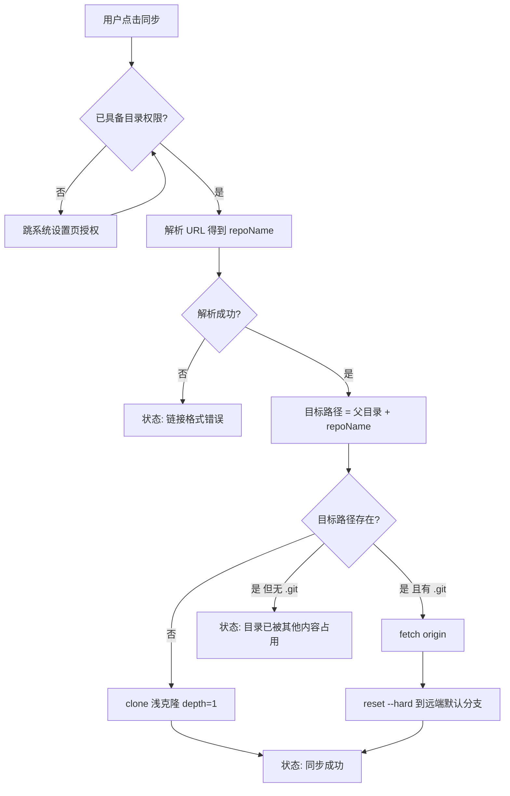

# SyncNote 技术方案

> 一个用于个人使用的 Android 小工具：输入 GitHub 仓库地址，把仓库同步到手机本地指定目录。
>
> 文档版本：v1.0 ｜ 日期：2026-10-27 ｜ 状态：待确认（见第 11 节）

---

## 1. 背景与目标

手机上想直接看某个 GitHub 仓库（比如自己的笔记仓库 `Notes`）的最新内容，但不希望每次都去网页翻。目标是做一个**极简单向同步工具**：

- 粘贴仓库地址
- 选一个本地目录
- 点一下同步
- 内容落到 `选中目录/<仓库名>/`，下次点同步就是增量更新

明确**不做**的功能：不做真正的版本管理客户端，不做分支切换、不做 commit / push、不做多仓库列表管理（v1 单仓库）。

---

## 2. 需求定义

### 2.1 功能需求

| 编号 | 需求 | 说明 |
|---|---|---|
| F1 | 仓库地址输入框 | 支持 `https://` 与 `git@` 两种写法，支持有无 `.git` 后缀 |
| F2 | Token 输入框 | **私有仓库必需**，长度不显示明文；公开仓库留空即可 |
| F3 | 目录选择 | 系统 SAF 选择器，用户可选**任意目录**作为父目录 |
| F4 | 同步按钮 | 首次 = clone，后续 = 拉取并强制对齐远端 |
| F5 | 状态反馈 | 同步中显示进度，结束显示成功/失败原因 |
| F6 | 路径记忆 | 记住上次的 URL、Token 与父目录，重启 App 自动回填 |

### 2.2 非功能需求

| 项 | 要求 |
|---|---|
| 目标设备 | Android 8.0 (API 26) 及以上，开发者本人真机 |
| 网络 | 仅 HTTPS 出网，无需代理配置 |
| 单次同步耗时 | 中等仓库（< 50MB）10 秒内完成，期间 UI 不卡顿 |
| 使用场景 | 个人侧载安装，不需要上架应用商店 |

---

## 3. 核心规则：目标路径推导

这是整个方案最关键的一条约定，必须落死。

### 3.1 公式

```
目标目录 = 用户选中的父目录 + "/" + 从 URL 解析出的仓库名
```

### 3.2 用户给出的例子

```
输入 URL      : https://github.com/wangminghuang/Notes.git
选择父目录    : 临时文件夹
─────────────────────────────────────────────
最终落盘位置  : 临时文件夹/Notes
```

注意：**不要再追加一层**。不是 `临时文件夹/Notes/Notes`，也不是 `临时文件夹/wangminghuang/Notes`。仓库所有者名 `wangminghuang` 只用于网络请求，不参与本地路径。

### 3.3 路径解析边界用例

| 输入 URL | 解析出的仓库名 | 落盘位置 |
|---|---|---|
| `https://github.com/wangminghuang/Notes.git` | `Notes` | `<父目录>/Notes` |
| `https://github.com/wangminghuang/Notes` | `Notes` | `<父目录>/Notes` |
| `https://github.com/wangminghuang/Notes/` | `Notes` | `<父目录>/Notes` |
| `https://github.com/wangminghuang/Notes.git?tab=readme` | `Notes` | `<父目录>/Notes` |
| `https://github.com/wangminghuang/Notes#readme` | `Notes` | `<父目录>/Notes` |
| `git@github.com:wangminghuang/Notes.git` | `Notes` | `<父目录>/Notes` |
| `https://github.com/wangminghuang` | — | 报错：缺少仓库名 |
| `https://github.com/` | — | 报错：地址不完整 |
| 空字符串 | — | 报错：请输入仓库地址 |

### 3.4 解析算法

```
1. trim 输入
2. 若是 SCP 风格（不含 "://" 且含 ":"）→ 取 ":" 之后的部分
   否则 → 用 URI 解析，取 path
3. 去掉 query（?）与 fragment（#）
4. 去掉首尾 "/"
5. 按 "/" 分割，取最后一段
6. 去掉结尾的 ".git"
7. 校验：非空、不等于 "." / ".."、匹配 ^[A-Za-z0-9._-]+$
   不匹配 → 报错（防止目录穿越或非法字符）
```

第 7 步的校验不是多余的：没有它，一个形如 `https://x.com/a/..` 的地址会让文件写到父目录之外。

### 3.5 关于"临时文件夹"

`临时文件夹` 只是文档里的举例，**不是写死的路径**。实际行为：

- App 不预设、不硬编码任何目录
- 用户通过系统选择器选**任意目录**（内部存储任意层级、SD 卡均不限制）
- 选择结果持久化，下次启动自动回填

所以 `临时文件夹/Notes` 只是"父目录 / 仓库名"这个公式的一个具体例子。Android 上并不存在 `/tmp`，若用户自己建了 `/storage/emulated/0/tmp` 并选中它，落盘就是 `/storage/emulated/0/tmp/Notes`。

---

## 4. 技术选型

### 4.1 Git 引擎

| 方案 | 优点 | 缺点 | 结论 |
|---|---|---|---|
| **JGit**（`org.eclipse.jgit`） | 纯 Java，Gradle 一行依赖；clone/fetch/reset/clean 全套 API；无 NDK | APK +2~3MB；不支持 Git LFS 自动拉取 | **采用** |
| 打包 git 可执行文件 + `ProcessBuilder` | 行为与桌面 git 完全一致 | Android 无现成二进制，需自行交叉编译 arm64，还要处理动态库依赖 | 不采用 |
| libgit2 + JNI | 体积小、性能好 | 需 NDK/CMake/胶水代码，是 demo 的数倍工作量 | 不采用 |
| 不用 git：下 zip 解压 | 十几行代码 | 无增量、每次全量下、无 `.git` 元数据 | 备选（仅当 JGit 受阻） |

**版本锁定：`org.eclipse.jgit:org.eclipse.jgit:5.13.3.202401111512-r`**

- 不用 6.x：6.x 编译目标为 Java 11 API，Android 上容易出现 `NoClassDefFoundError`（如 `java.nio.file` 相关类缺失）
- 5.13.x 面向 Java 8，是社区在 Android 上验证最多的版本

### 4.2 目录访问方式

| 方案 | 机制 | 优点 | 缺点 | 结论 |
|---|---|---|---|---|
| **A. 所有文件访问权限** | `MANAGE_EXTERNAL_STORAGE` → 拿到 `java.io.File` | JGit 可直接写入；路径直观 | Android 11+ 需跳设置页手动授权 | **采用（写入层）** |
| B. SAF 目录选择 | `ACTION_OPEN_DOCUMENT_TREE` → `content://` URI | 系统原生选择器，体验好 | JGit 不接受 `content://`，必须中转拷贝 | 可作选择层，不作写入层 |
| C. 应用专属目录 | `getExternalFilesDir()` | 零权限 | 用户无法通过文件管理器访问，失去"选目录"意义 | 不采用 |

**已确定组合：B + A**

- **选目录**用 SAF 系统选择器（`ActivityResultContracts.OpenDocumentTree`），用户熟悉，不用自建文件浏览器
- 拿到 URI 后还原为真实路径：`DocumentsContract.getTreeDocumentId()` → `primary:tmp` → `/storage/emulated/0/tmp`
- **实际写入**走 A 的 `File` API，JGit 直接操作

还原失败时（外接存储卷，docId 形如 `1234-5678:path`，映射不可靠）不做内置浏览器兜底，而是明确提示"请改选内部存储中的目录"——比给一个功能残缺的浏览器更清楚。

### 4.3 UI

Kotlin + Jetpack Compose。四个控件：`OutlinedTextField`、两个 `Button`、一个 `Text`。比 XML 布局少一半代码，符合"简单能跑"的目标。

### 4.4 版本基线（已在本机验证可编译）

| 项 | 版本 |
|---|---|
| AGP | 9.6.0-alpha01（Studio 模板给出，实测可用） |
| Gradle | 9.6.0 |
| compileSdk / targetSdk | 37 / 37 |
| minSdk | **26**（不可再低，见 6.2） |
| Kotlin | 2.2.10 |
| Compose BOM | 2026.02.01 |

---

## 5. 架构与文件结构

```
app/src/main/java/com/example/syncnote/
├── MainActivity.kt          UI 入口：三个控件 + 状态机 + 权限申请
├── SyncViewModel.kt        持有 UI 状态（idle/syncing/success/error），调用 GitSync
├── GitSync.kt               核心同步逻辑：URL 解析、clone、fetch+reset
├── PathResolver.kt          SAF URI → 真实路径；父目录 + 仓库名 → 目标路径
└── ui/theme/…               模板自带
```

分层原则：**UI 不碰 git，git 不碰 UI**。`GitSync` 只接收 `(url, targetDir, progressCallback)`，返回结果或抛异常。

---

## 6. 核心流程

### 6.1 同步流程



### 6.2 三种情况的处理语义

| 目标路径状态 | 动作 | 说明 |
|---|---|---|
| 不存在 | `clone` | 拉完整历史。**JGit 5.13 没有 depth 参数，做不了浅克隆**（见 7.3） |
| 存在且含 `.git` | `fetch` + `reset --hard origin/<默认分支>` + `clean` | 强制对齐远端，本地改动被丢弃 |
| 存在但不含 `.git` | **报错，不删任何文件** | 绝不静默删除用户已有数据 |

### 6.3 默认分支的确定

`refs/remotes/origin/HEAD` 不一定存在，不能直接依赖。按优先级依次尝试：

1. `origin/HEAD` 指向的引用（若存在）
2. `origin/main`
3. `origin/master`
4. 远端 `refs/heads/*` 中字典序第一个

### 6.4 清理多余文件：默认镜像远端

**已确定策略：本地以远端为准。** 用户明确表示"本地内容不用管，你更新就行"，因此默认执行：

```
fetch → reset --hard origin/<branch> → clean -d
```

`reset --hard` 让被跟踪文件全部对齐远端提交，`clean -d` 清掉远端不存在的残留文件与空目录。

一个刻意的保留：**不调用 `setIgnore(true)`**。JGit 的 `CleanCommand` 默认不处理被 `.gitignore` 忽略的文件，所以用户自己放进去、且被忽略的文件不会被误删。真要彻底镜像加一行即可，但默认不做。

---

## 7. 关键实现细节

### 7.1 依赖与构建配置

```kotlin
dependencies {
    implementation("org.eclipse.jgit:org.eclipse.jgit:5.13.3.202401111512-r")
}
```

JGit 会传递引入 `jsch`、`JavaEWAH`，它们各自携带 `META-INF/DEPENDENCIES` 等文件，Gradle 合并资源时会直接失败。必须排除：

```kotlin
packaging {
    resources {
        excludes += setOf(
            "META-INF/DEPENDENCIES",
            "META-INF/LICENSE", "META-INF/LICENSE.txt",
            "META-INF/NOTICE", "META-INF/NOTICE.txt",
            "META-INF/INDEX.LIST",
            "META-INF/*.SF", "META-INF/*.DSA", "META-INF/*.RSA"
        )
    }
}
```

### 7.2 minSdk 为什么必须是 26

JGit 5.x 内部使用 `java.nio.file`（`FileRepositoryBuilder`、`FS` 等），该包在 Android 上 **API 26 才引入**。低于 26 编译期就会报找不到类。这不是可配置项，是硬约束。

### 7.3 JGit 调用要点

```kotlin
// 首次克隆
Git.cloneRepository()
    .setURI(authUrl)
    .setDirectory(targetDir)
    .setProgressMonitor(monitor)
    .call()

// 增量更新
git.fetch()
    .setRemote(authUrl)
    .setRefSpecs(RefSpec("+refs/heads/*:refs/remotes/origin/*"))
    .setRemoveDeletedRefs(true)
    .setProgressMonitor(monitor)
    .call()

git.reset()
    .setMode(ResetType.HARD)
    .setRef("refs/remotes/origin/${branch}")
    .call()

git.clean().setCleanDirectories(true).call()
```

**关于浅克隆（重要更正）**：JGit **5.13.3 的 `CloneCommand` 没有 `setDepth` 方法**，`FetchCommand` 同样没有——用 `strings` 直接查 jar 里的 class 常量池确认过，编译期就报 `Unresolved reference: setDepth`。浅克隆是 6.x 之后才提供的能力。因此本项目放弃浅克隆，接受全量拉取历史；如果仓库历史巨大导致首次克隆慢，唯一出路是升到 JGit 6.x 并自行处理 Java 11 API 兼容问题，v1 不做。

**同样注意**：5.13 的 `ProgressMonitor` 接口只有 `start / beginTask / update / endTask / isCancelled` 五个方法，**没有 `showDuration`**（那是更高版本加的）。照着新版文档抄会编译失败。

`ProgressMonitor.update(int completed)` 回调非常高频，必须节流（本项目：百分比变化 + 最小间隔 150ms），否则 Compose 重组风暴会让界面卡死。

### 7.4 线程模型

所有 git 操作在 `Dispatchers.IO` 上执行（`GitSync.sync` 是 `suspend` 函数），UI 通过状态机回传：

```kotlin
// UI 状态（MainActivity 内部）
sealed interface UiState {
    data object Idle : UiState
    data class Running(val percent: Int, val phase: String) : UiState
    data class Done(val path: String, val message: String) : UiState
    data class Error(val message: String) : UiState
}

// 同步结果（GitSync 返回）
sealed interface SyncResult {
    data class Success(val dir: File, val message: String) : SyncResult
    data class Failed(val message: String) : SyncResult
}
```

不用 `AsyncTask`、不在主线程碰 git、不在 `onCreate` 里同步调用。

### 7.5 权限方案

```xml
<uses-permission android:name="android.permission.INTERNET" />
<uses-permission android:name="android.permission.MANAGE_EXTERNAL_STORAGE"
    tools:ignore="ScopedStorage" />
<!-- 仅 API 26~29 需要，30+ 由 MANAGE_EXTERNAL_STORAGE 覆盖 -->
<uses-permission android:name="android.permission.READ_EXTERNAL_STORAGE"
    android:maxSdkVersion="29" />
<uses-permission android:name="android.permission.WRITE_EXTERNAL_STORAGE"
    android:maxSdkVersion="29" />
```

`INTERNET` 权限在新模板里**不会自动生成**（只有 debug 变体的清单里带），漏写会在真机上抛 `UnknownHostException`，很容易被误判成网络问题。

授权跳转：

```kotlin
Intent(Settings.ACTION_MANAGE_APP_ALL_FILES_ACCESS_PERMISSION,
       Uri.parse("package:$packageName"))
```

返回后**必须**重新检查 `Environment.isExternalStorageManager()`，`onActivityResult` 的 resultCode 不可信。授权状态在 `onResume` 里重检最稳。

### 7.6 错误分类与提示

| 异常 | 用户可见提示 |
|---|---|
| `InvalidRemoteException` / `TransportException` | 仓库不存在或无权限访问 |
| `UnknownHostException` | 无法连接网络（DNS 失败），检查网络或代理 |
| `SSLHandshakeException` | 证书校验失败，可能被网络中间设备拦截 |
| 目录非空且无 `.git` | 该目录已有其他内容，请换一个目录或手动清空 |
| `IOException` 写入失败 | 存储空间不足或无写入权限 |
| 其他 | 显示异常简单类名 + message，便于自查 |

### 7.7 私有仓库的 Token 处理

目标仓库是私有仓库，因此 F2 的 Token 输入框是必需能力，不是可选加分项。

实现方式：把 token 拼进 URL 的 userinfo 段

```
https://ghp_xxxxxxxx@github.com/wangminghuang/Notes.git
```

GitHub 对 HTTPS 的 Basic 认证接受"用户名任意 + 密码为 PAT"，把 token 放在 userinfo 位置即可通过。

两个必须做的收尾：

1. **请求完成后把 `origin` 的地址改回不带 token 的形式**，否则 token 会以明文留在 `.git/config` 里：
   ```kotlin
   val config = git.repository.config
   config.setString("remote", "origin", "url", cleanUrl)
   config.save()
   ```
2. **`fetch` 时不依赖 `origin` 已存的地址**，直接 `setRemote(authUrl)` 并显式给出 refspec，这样即使本地 `.git/config` 是干净地址也能带上凭据。

```kotlin
git.fetch()
    .setRemote(authUrl)                                        // 带 token 的地址
    .setRefSpecs(RefSpec("+refs/heads/*:refs/remotes/origin/*"))
    ...
```

**已知妥协**：Token 存在 `SharedPreferences` 里是明文的（为了 F6 自动回填）。个人设备 + demo 场景可接受；要更安全应接 `EncryptedSharedPreferences` 或 Android Keystore，v1 不做。

---

## 8. 已知风险

| 风险 | 影响 | 应对 |
|---|---|---|
| SAF URI → 真实路径的还原在非主存储卷上可能失败 | 用户选了 SD 卡目录时无法写入 | 解析失败时降级为内置目录浏览器；或限定只能选主存储 |
| `MANAGE_EXTERNAL_STORAGE` 在新版 Android 上可能进一步收紧 | 权限申请被系统拒绝 | 已在 targetSdk 37 上实测授权流程可用；若后续失效，回退到"应用专属目录 + 手动拷贝" |
| JGit 5.13 较老（2024 年） | 新协议特性可能不支持 | 仅走 HTTPS clone，不涉及复杂协议，风险低 |
| JGit 不支持 Git LFS | LFS 仓库只能拉到指针文件 | v1 忽略；README 中不含有大文件即可 |
| 仓库很大时首次克隆耗时长 | 用户以为卡死 | 浅克隆 + 进度百分比 + 可取消 |
| 同步过程中切后台被杀 | 同步中断留下半成品 | v1 接受：中断后重新点同步，`.git` 不完整会被识别并提示清理 |
| **无浅克隆**：JGit 5.13 没有 depth 能力 | 历史很长的仓库首次克隆慢、占空间 | 换 JGit 6.x 或改用 zip 下载；v1 接受 |
| Token 明文存于 SharedPreferences | 设备被 root / 备份时可读 | 个人设备可接受；后续换 EncryptedSharedPreferences |

---

## 9. 验收标准

1. 输入 `https://github.com/wangminghuang/Notes.git`，选择 `/storage/emulated/0/tmp`，同步后存在 `/storage/emulated/0/tmp/Notes/`，且能从系统文件管理器打开看到文件。
2. 再次点击同步，能拉到该仓库此后新增的提交内容，不做全量重下；远端删除的文件在本地同步消失。
3. **私有仓库：填入有效 Token 能成功克隆；Token 填错时报"认证失败"，而不是笼统的网络错误。**
4. 克隆完成后检查 `.git/config`，`url` 里**不包含** token 明文。
5. 输入非法链接（`https://github.com/wangminghuang`）有明确报错，不产生任何目录。
6. 未授权时点击同步，能正确跳转授权页；授权后返回可直接同步。
7. 目标目录里已有非 git 内容时，同步被拒绝且**原有文件一个不删**。
8. 同步过程中界面不卡（可滑动、按钮显示 loading），完成后显示结果路径。

---

## 10. 实施进度

| 阶段 | 内容 | 状态 |
|---|---|---|
| P1 | 加 JGit 依赖 + packaging 排除 + manifest 权限，跑通构建 | 已完成 |
| P2 | `PathResolver`：URL 解析 + 目标路径推导 | 已完成 |
| P3 | `GitSync`：clone / fetch+reset+clean + 进度节流 | 已完成 |
| P4 | `MainActivity` 界面 + 状态机 | 已完成 |
| P5 | 权限申请跳转 + SAF 目录选择 | 已完成 |
| P6 | 真机联调、错误提示打磨 | 待进行 |

代码文件：

```
app/src/main/java/com/example/syncnote/
├── MainActivity.kt   Compose 界面 + 状态机 + 权限流程
├── GitSync.kt        clone / fetch + reset --hard + clean，进度回调，错误分类
└── PathResolver.kt   仓库名解析、目标路径推导、SAF URI → 真实路径
```

构建产物：`app/build/outputs/apk/debug/app-debug.apk`，约 13MB（含 JGit），`assembleDebug` 已验证通过。

---

## 11. 已确认决策（2026-10-27）

原先 4 个待确认问题已拍板，记录如下，后续不再反复：

| # | 问题 | 结论 |
|---|---|---|
| 1 | 目录选择方式 | **用系统 SAF 选择器**。路径还原失败时提示"改选内部存储目录"，不自建浏览器 |
| 2 | "临时文件夹"含义 | **只是举例**。用户可选任意目录，全部授予「所有文件访问」权限 |
| 3 | 重复同步策略 | **本地以远端为准**，`reset --hard` + `clean` 强制镜像 |
| 4 | 私有仓库 | **必须支持**，UI 增加 Token 输入框 |

实现期额外发现两条与预期不符的事实，已写进 7.3：

- JGit 5.13.3 **没有** `setDepth`，浅克隆不可用
- 同版本 `ProgressMonitor` **没有** `showDuration`

---

## 附录：为什么不用 SAF 那一套直接写文件

技术上 SAF 完全能写文件，问题在于它给出的是 `content://` 树 URI + `DocumentFile` 抽象，而 JGit 的所有 API（`cloneRepository().setDirectory()`、`reset()`、`fetch()`）都要求一个真实的 `java.io.File`。要么把 JGit 的文件系统层整体换成自定义实现（工作量大且侵入内部 API），要么 clone 到应用私有目录再递归拷贝（多一次全量 IO，且丢失 `.git` 增量能力）。所以选择：**SAF 只负责"选"，`File` 负责"写"**。
